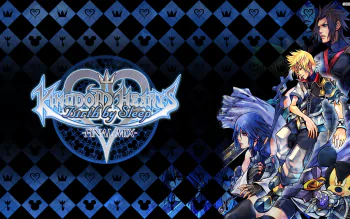
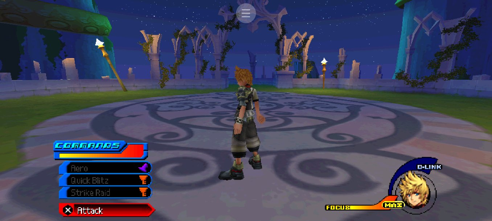
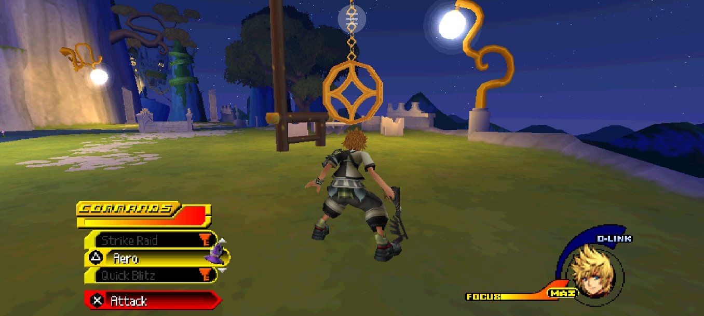
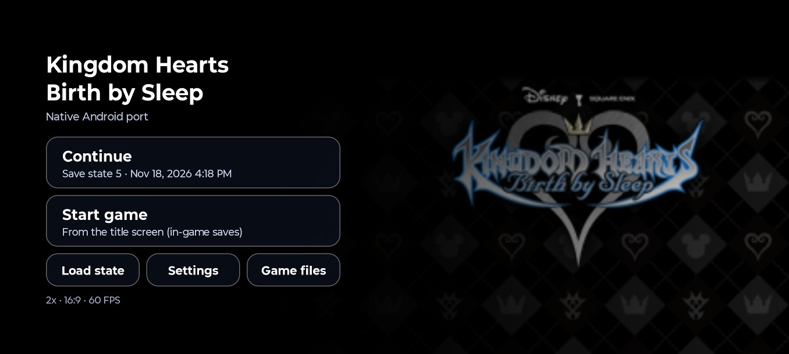
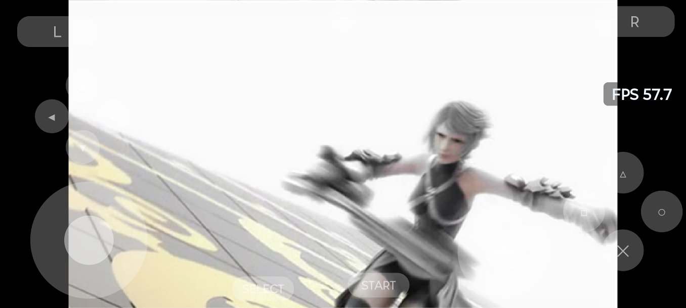

<p align="center"></p>

# kh-bbs-recomp

**Kingdom Hearts: Birth by Sleep (PSP) running natively on Android**: the USA release and **Final Mix** (Japan,
with the English fan translation). The game's own code is translated to C++ ahead
of time and compiled for your phone (*static recompilation*), instead of being emulated. The PSP's system and graphics
are re-implemented by [psp-native-runtime](https://github.com/dguillot-gh/psp-native-runtime) (the `runtime/` submodule).

> **No game data is included.** You build it from your own copy of the disc. Please don't share builds: the APK and the
> game folder contain the game.

<table>
  <tr>
    <td></td>
    <td></td>
  </tr>
  <tr>
    <td></td>
    <td></td>
  </tr>
  <tr>
    <td></td>
    <td></td>
  </tr>
</table>

<sub>Moto G Stylus 2025, 2x resolution, "Phone screen" aspect, original textures.</sub>

## What works

- Boot to gameplay, with **sound** (music, voices, effects).
- **Movies** (the story cutscenes): H.264 decoded by the phone's hardware decoder, with their ATRAC3plus audio.
- **Launcher**: Continue (latest save state), Start, Load state, Settings, Game files. Its background is your own
  disc's art.
- **First-run setup on the phone**: pick your ISO and the app copies the game files and decrypts what it needs
  on the device (a bundled GPL-3.0 helper, see [android/decrypt](android/decrypt/README.md)). No PC step, nothing
  downloaded.
- **60 FPS mode** (toggle in the menu; ~55-60 FPS on a Moto G Stylus 2025).
- **Save states** (8 slots), plus the game's own saves.
- **Boss checkpoint**: when a boss fight starts, a save state is taken automatically; **Restart boss fight** in the
  menu goes straight back to the start of the fight (found from the game's own `SetBossCamera` script command).
- **Story slots**: one automatic save state per character (Ventus, Aqua, Terra), kept current when you leave the
  app, quit, or save. **Switch story…** in the menu and **▶ Ventus / Aqua / Terra** in the launcher jump between
  the three stories without the title screen. A character's slot appears the first time you play them.
- **Swap ○ / ✕** (menu and launcher settings): on by default for Final Mix, so ✕ confirms like the USA release.
- **Touch controls** you can move, resize and hide, with an analog stick and a **Shotlock** button (tap to lock L+R on, gold while on, released by a hit, firing or a second tap; or hold it); **gamepads** (both sticks, D-pad, triggers).
- **Right-stick camera** (a dual-analog camera, like the RemasteredControls mod).
- **Resolution** 1x-4x and **aspect ratio**: 16:9 or the full phone screen (wider view, not stretched).
- **HD texture packs** in PPSSPP format, such as BBS HD ReMix: import the ZIP from the in-game menu
  (see [HD textures](#hd-textures-optional)).

Shadows, glows and hit effects render.

**Not yet:** the Windows build is behind the Android one (no movies or ATRAC music there yet). See `NOTES.md` for the detailed log.

## Supported dumps

| Game | Region | Product code | ISO SHA-1 |
|---|---|---|---|
| Kingdom Hearts: Birth by Sleep (En,Fr,Es) | USA | ULUS-10505 | `0a61928fc0eaa78f169b4a172ba6165ecf8564a0` |
| Kingdom Hearts: Birth by Sleep Final Mix, English patch by Truthkey v1.0.12 | Japan | ULJM-05775 | `01240b99b5b8104299ad6f210cb49abaa385bf02` |

The Final Mix patch is distributed as a `.chd`; convert it to an ISO first (`chdman extractdvd -i <file>.chd -o
<file>.iso`, chdman from MAME). Final Mix's program is not encrypted, and the UNDUB release carries the same program
(as `EBOOT.OLD`), so it should build too (untested). Other releases are untested (`BBS_ANY_DUMP=1` lets
`1-EXTRACT.sh` accept them).

Each disc builds its own app: `com.psprecomp.bbs` ("KH BBS Recomp") for the USA disc and `com.psprecomp.bbsfm`
("KH BBS Final Mix") for Final Mix, so both can be installed side by side. Everything disc-specific (camera hooks,
60 FPS, boss checkpoint, story slots) is found or listed per disc in `scripts/` and `host/main.cpp`.

## Building

Needs Git (Git Bash on Windows), Python 3, clang ([llvm-mingw](https://github.com/mstorsjo/llvm-mingw) on Windows),
and for Android the SDK (build-tools 36, platform 35, cmake 3.31), NDK r29 and JDK 17.

```bash
git clone --recurse-submodules https://github.com/dguillot-gh/kh-bbs-recomp.git
cd kh-bbs-recomp
bash scripts/1-EXTRACT.sh "/path/to/Kingdom Hearts - Birth by Sleep (USA).iso"
bash scripts/2-DECRYPT.sh
bash scripts/3-GENERATE.sh       # generates the C++ (several minutes)
bash scripts/5-BUILD-ANDROID.sh  # -> build/android/bbs-recomp-debug.apk
bash scripts/6-INSTALL-PHONE.sh
```

Everything made from your disc goes into `game/` and build output into `build/`; git ignores both.
The same steps build Final Mix: the scripts recognise the disc (`2-DECRYPT.sh` just copies its unencrypted program)
and give the app its own package. To keep both discs, give the second one its own folder, e.g.
`BBS_GAME_DIR=game-fm` for steps 1-6 (and `BUILD_DIR=build/android-fm` for step 5).
On first start the app asks for your ISO (put it in Downloads, then **Choose ISO…**): it copies the disc into its
own storage (about 4 GB) and decrypts `EBOOT.BIN` and, on first use, `BBS1-3.DAT` on the phone.

## HD textures (optional)

The [BBS HD ReMix](https://github.com/AkiraJkr/Birth-by-Sleep-HD-ReMix) fan pack is not part of this project and isn't
bundled with the app. It covers both the USA disc and Final Mix (its `textures.ini` lists ULUS10505 and ULJM05775).
To use it:

1. On your phone, open the pack's GitHub page and tap **Code → Download ZIP** (about 550 MB; Wi-Fi recommended).
   Keep the ZIP as it is; you don't need to unzip it. Any other PPSSPP-format pack (a ZIP with a `textures.ini`) works too.
2. In the game, open the menu (☰) → **HD textures…** → **Import a texture pack ZIP…** and pick the ZIP.
3. When it says "HD textures installed", tap **Restart now**. Save a state first if you're mid-game.

You need about 1.2 GB free while it unpacks; afterwards you can delete the ZIP. The same menu turns the textures off
or removes them. They look best at **Resolution 2x or higher**.

**In-game menu:** the ☰ button, the phone's Back button, or Select+Start on a gamepad.

## Credits

- [psp-native-runtime](https://github.com/dguillot-gh/psp-native-runtime) (MIT), grown from
  [PSPRecomp](https://github.com/jessicanataliagta/PSPRecomp); its `CREDITS.md` lists everything it builds on, including
  [lcs-recomp](https://github.com/elmasas/lcs-recomp) (Vulkan renderer) and
  [PSPRecomp-VCS-Android](https://github.com/codepdbh/PSPRecomp-VCS-Android) (audio, MIT).
- [Portable Ops Native](https://github.com/zexk/portable-ops-native) (MIT): designs for code overlays and movie skipping.
- [pspdecrypt](https://github.com/John-K/pspdecrypt) (GPL-3.0): only in the local decrypting tool, never in the app.
- Ideas re-implemented, not copied: [PPSSPP](https://github.com/hrydgard/ppsspp) (texture-pack format, PSP behaviour),
  TheFloW's [RemasteredControls](https://github.com/TheOfficialFloW/RemasteredControls) (right-stick camera),
  [OpenKH](https://openkh.dev/bbs/) (file formats).

Kingdom Hearts is © Disney / Square Enix. This project is not affiliated with them.
