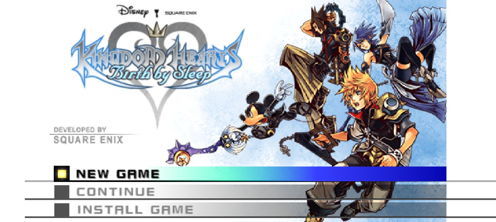
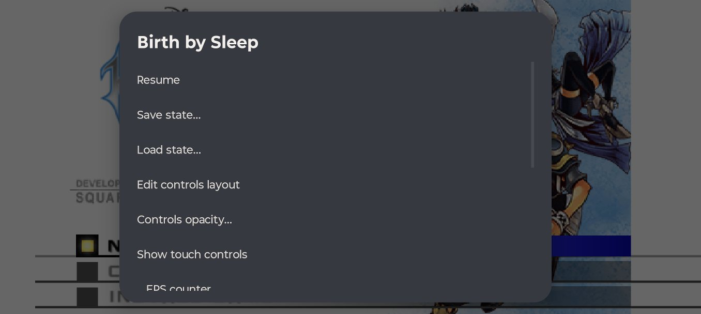

<p align="center"></p>

# kh-bbs-recomp

**Kingdom Hearts: Birth by Sleep (PSP) running natively on Android.** The game's own code is translated to C++ ahead
of time and compiled for your phone (*static recompilation*), instead of being emulated. The PSP's system and graphics
are re-implemented by [psp-native-runtime](https://github.com/dguillot-gh/psp-native-runtime) (the `runtime/` submodule).

> **No game data is included.** You build it from your own copy of the disc. Please don't share builds: the APK and the
> game folder contain the game.

<table>
  <tr>
    <td></td>
    <td></td>
  </tr>
  <tr>
    <td></td>
    <td></td>
  </tr>
</table>

<sub>Moto G Stylus 2025, 2x resolution, "Phone screen" aspect, original textures.</sub>

## What works

- Boot to gameplay, with **sound** (music, voices, effects).
- **60 FPS mode** (toggle in the menu; ~55-60 FPS on a Moto G Stylus 2025).
- **Save states** (8 slots), plus the game's own saves.
- **Touch controls** you can move, resize and hide, with an analog stick; **gamepads** (both sticks, D-pad, triggers).
- **Right-stick camera** (a dual-analog camera, like the RemasteredControls mod).
- **Resolution** 1x-4x and **aspect ratio**: 16:9 or the full phone screen (wider view, not stretched).
- **HD texture packs** in PPSSPP format, such as [BBS HD ReMix](https://github.com/AkiraJkr/Birth-by-Sleep-HD-ReMix)
  (you download it yourself; see below).

**Not yet:** movies are skipped; shadows and full-screen glow effects are off (they still render incorrectly);
the Windows build is behind the Android one. See `NOTES.md` for the detailed log.

## Supported dump

| Game | Region | Product code | ISO SHA-1 |
|---|---|---|---|
| Kingdom Hearts: Birth by Sleep (En,Fr,Es) | USA | ULUS-10505 | `0a61928fc0eaa78f169b4a172ba6165ecf8564a0` |

Other releases are untested (`BBS_ANY_DUMP=1` lets `1-EXTRACT.sh` accept them).

## Building

Needs Git (Git Bash on Windows), Python 3, clang ([llvm-mingw](https://github.com/mstorsjo/llvm-mingw) on Windows),
and for Android the SDK (build-tools 36, platform 35, cmake 3.31), NDK r29 and JDK 17.

```bash
git clone --recurse-submodules https://github.com/dguillot-gh/kh-bbs-recomp.git
cd kh-bbs-recomp
bash scripts/1-EXTRACT.sh "/path/to/Kingdom Hearts - Birth by Sleep (USA).iso"
bash scripts/2-DECRYPT.sh
bash scripts/3-GENERATE.sh       # generates the C++ (several minutes)
bash scripts/5-BUILD-ANDROID.sh  # -> build/android/bbs-recomp-debug.apk
bash scripts/6-INSTALL-PHONE.sh
```

Everything made from your disc goes into `game/` and build output into `build/`; git ignores both.
The install script doesn't copy everything the game needs yet (the ISO and the offline-decrypted `BBS1-3.DAT`).

**HD textures:** copy the pack (the folder with `textures.ini`) to
`Android/data/com.psprecomp.bbs/files/textures/` on the phone, then use "HD texture pack" in the menu. 2x resolution
or higher is recommended.

**In-game menu:** the ☰ button, the phone's Back button, or Select+Start on a gamepad.

## Credits

- [psp-native-runtime](https://github.com/dguillot-gh/psp-native-runtime) (MIT), grown from
  [PSPRecomp](https://github.com/jessicanataliagta/PSPRecomp); its `CREDITS.md` lists everything it builds on, including
  [lcs-recomp](https://github.com/elmasas/lcs-recomp) (Vulkan renderer) and
  [PSPRecomp-VCS-Android](https://github.com/codepdbh/PSPRecomp-VCS-Android) (audio, MIT).
- [Portable Ops Native](https://github.com/zexk/portable-ops-native) (MIT): designs for code overlays and movie skipping.
- [pspdecrypt](https://github.com/John-K/pspdecrypt) (GPL-3.0): only in the local decrypting tool, never in the app.
- Ideas re-implemented, not copied: [PPSSPP](https://github.com/hrydgard/ppsspp) (texture-pack format, PSP behaviour),
  TheFloW's [RemasteredControls](https://github.com/TheOfficialFloW/RemasteredControls) (right-stick camera),
  [OpenKH](https://openkh.dev/bbs/) (file formats).

Kingdom Hearts is © Disney / Square Enix. This project is not affiliated with them.
